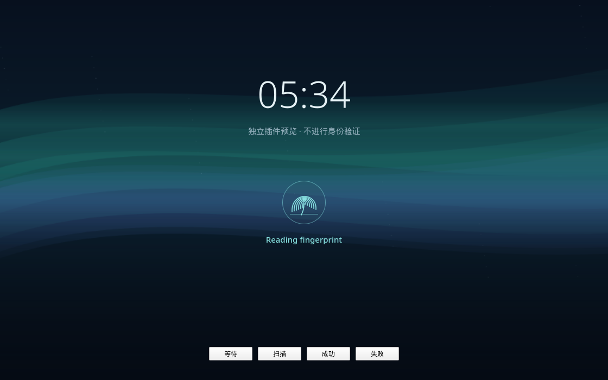

# Aurora Fingerprint — independent Plasma wallpaper plugin

[中文说明](README.zh-CN.md)

An optional, source-only **Plasma/Wallpaper KPackage** for an animated aurora
background and read-only fingerprint feedback. It works alongside the fingerprint
driver; it is not part of the driver or an authentication backend.



## Integration and updates

- Installs under `/usr/local/share/plasma/wallpapers/` with its own plugin ID.
- Selects the plugin in the desktop user's lock-screen configuration and Plasma
  Login Manager's configuration. It changes no KDE package file, binary, service
  unit, PAM stack or Polkit rule, and requires no compilation.
- Uses a read-only listener for fprintd's `VerifyStatus`, `VerifyFingerSelected`
  and device properties. It never calls Claim, VerifyStart, EnrollStart or Delete.
- Waiting pulses, finger-present shows a scan line, match shows a green check,
  and a failed match shows a red retry message. Idle hides the indicator.
  Drivers that do not expose `finger-present` remain in waiting until a result;
  the plugin does not invent a touch or scanning event.
- The indicator is a non-interactive item in the host window, visually parented
  above its wallpaper blur; it opens no extra lock-screen window and accepts no
  password, fingerprint or input.
- Normal KDE upgrades do not require rebuilding this QML plugin. Future QML API
  changes can still require source updates. If the optional DBus monitor fails
  to load, the background remains separate and can still render.

Tested with KDE Plasma 6.7.5 / Qt 6.11.2 on Fedora 44. **Plasma Login Manager**
is the supported boot greeter; this installer does not configure SDDM. Success
feedback can be brief because the authenticating host closes its window after
success; this plugin never delays or controls unlocking.

The plugin only displays actual fingerprint requests. If boot login is password-
only, the background works but no fingerprint indicator is fabricated. Enabling
fingerprint authentication for a login manager is a separate, optional PAM
integration: see the boot-login section in the repository README.

## Install

From the repository root, using your normal desktop username:

```bash
sudo python3 ui/install.py --install "$USER"
```

The installer backs up previous selections and any existing copy of this plugin.
Save the printed rollback command. The background is used at the next lock screen
and the next Plasma Login Manager startup. Installation does not restart the
display manager or log you out. The plugin itself needs KDE's existing QML modules;
it needs no Python process or background helper at runtime.

Use **Meta + L** to check the lock screen, with your password available.

## Preview

On Fedora, install optional preview/test dependencies:

```bash
sudo dnf install python3-pyside6 python3-gobject dbus-daemon
python3 ui/preview/run-preview.py
```

The window has buttons for waiting, scanning, success and failure. These are
explicit preview states, not authentication results. To render a screenshot:

```bash
python3 ui/preview/run-preview.py --screenshot /tmp/aurora.png --mode scanning
```

## Tests

On a KDE system with the `org.kde.plasma.workspace.dbus` QML module installed:

```bash
dbus-run-session -- python3 ui/tests/test-monitor.py
python3 ui/tests/test-wallpaper.py
```

The first uses a private fake D-Bus service to test discovery, waiting, actual
finger-property changes, success, failure and disconnection. It never registers
the fake on the real system bus. The second loads a real WallpaperItem offscreen
and checks that idle feedback is hidden and its visual parent bypasses wallpaper
blur. The native lock-screen test mode was also loaded offscreen without QML
errors on the test machine. A real no-touch fprintd check also delivered waiting → failure → idle to the read-only monitor. Full cold-boot visual verification remains pending.

## Configuration and rollback

The wallpaper's settings expose **Reduce motion** and **Show live fingerprint
feedback**. Reduced motion stops the moving aurora and breathing/scan animation.

To restore previous selections, use the exact directory printed by the installer:

```bash
sudo python3 ui/install.py --restore /var/lib/oms-aurora-ui-backups/ACTUAL_BACKUP_DIRECTORY
```

The restore action changes only the wallpaper-selection keys and restores/removes
this plugin. It leaves unrelated configuration and authentication settings intact.
Sources use LGPL-2.1-or-later; see the repository LICENSE.
